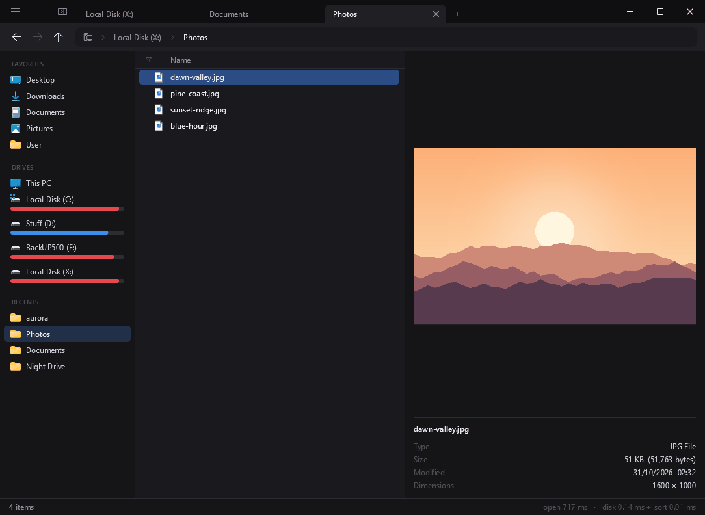
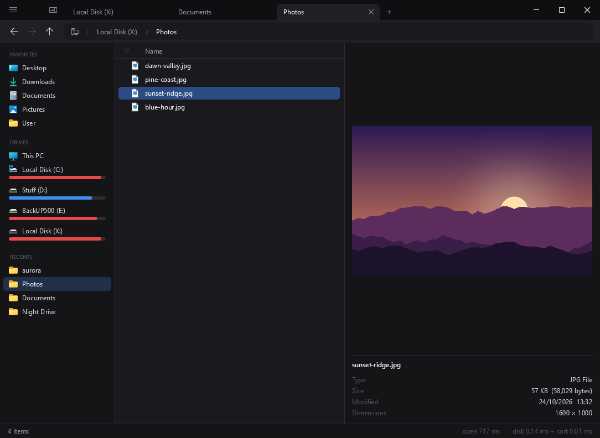
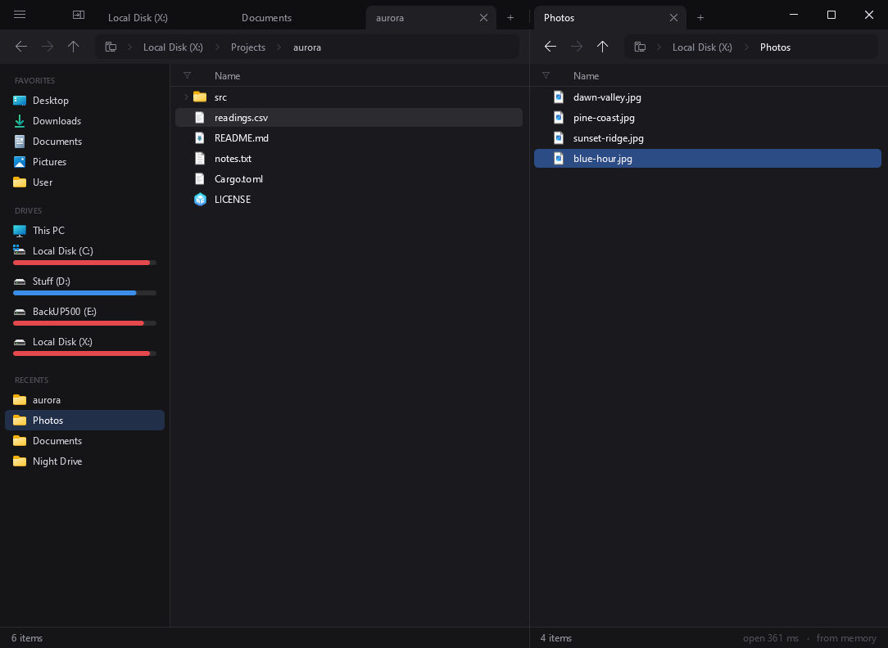
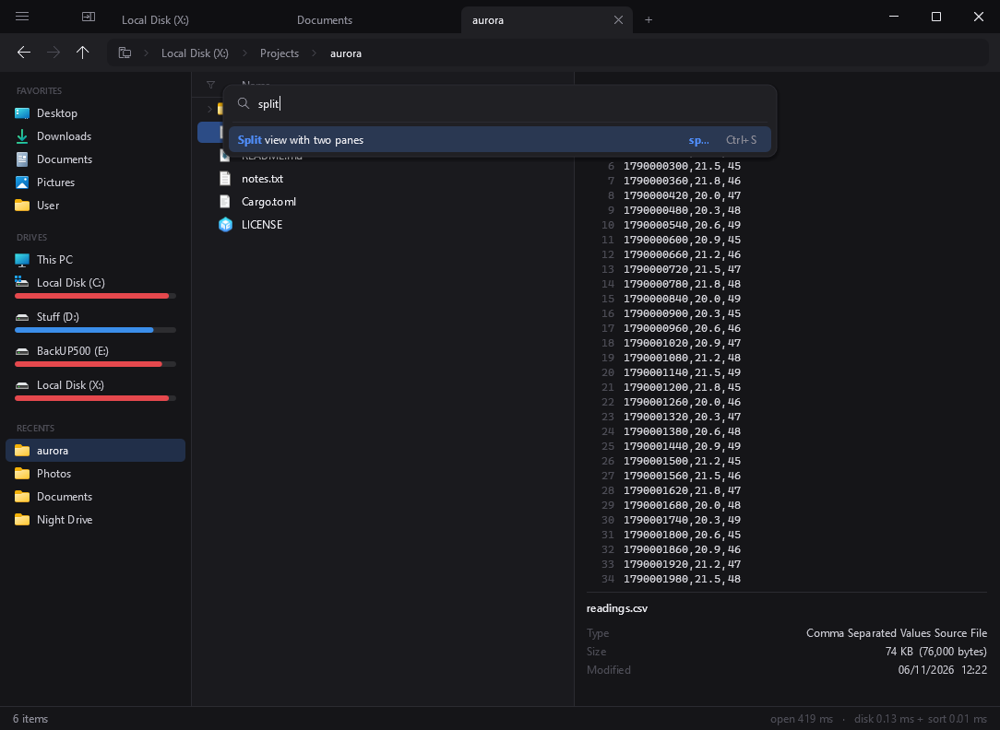

<div align="center">


# Jolt

**The file explorer for Windows that keeps up with you.**<br>
Folders open instantly. One small file, no dependencies, no telemetry.

[](https://github.com/SynrgStudio/jolt/releases/latest)
[](https://github.com/SynrgStudio/jolt/releases)
[](https://github.com/SynrgStudio/jolt/actions/workflows/build.yml)
[](LICENSE)


<a href="https://github.com/SynrgStudio/jolt/releases/latest/download/jolt.exe"></a>

[**Docs: jolt.synrgs.tech**](https://jolt.synrgs.tech) &nbsp;·&nbsp; [Features](#features) &nbsp;·&nbsp; [Install](#install) &nbsp;·&nbsp; [Shortcuts](#keyboard-and-mouse) &nbsp;·&nbsp; [Configuration](#configuration) &nbsp;·&nbsp; [For developers](#for-developers)

<br>



<sub>A scripted tour with demo files. The pacing is set by the script, so it doesn't show real speed.</sub>

</div>

---

## Features

<table>
<tr>
<td width="33%" valign="top"><b>⚡ Instant folders</b><br>Reads folders with a low-level Windows API and keeps visited ones in memory, so going back takes no time.</td>
<td width="33%" valign="top"><b>🔎 Find anything</b><br>Ctrl+P searches everything on your drives. Just start typing to fuzzy-filter any folder.</td>
<td width="33%" valign="top"><b>🖼️ Preview</b><br>Space shows images, code, folder contents and thumbnails right next to the list.</td>
</tr>
<tr>
<td valign="top"><b>🗂️ Tabs and split view</b><br>Simple tabs and two panes, each with its own, restored just as you left them.</td>
<td valign="top"><b>🔥 Recents that learn</b><br>Folders rise by how much you really use them, not by what you opened last.</td>
<td valign="top"><b>💽 Live drive space</b><br>Hover a drive to see its free and total space, updated every second.</td>
</tr>
<tr>
<td valign="top"><b>🎛️ Views per folder</b><br>Sort, group and filter each folder its own way, with rules applied instantly.</td>
<td valign="top"><b>⌨️ Keyboard first</b><br>A command palette, and any shortcut can be changed with one click.</td>
<td valign="top"><b>↩️ Undo</b><br>Renamed, moved or sent something to the Recycle Bin by mistake? Ctrl+Z.</td>
</tr>
<tr>
<td valign="top"><b>🎨 Yours to customize</b><br>Colors, font, sizes and columns in one plain text file that reloads on save.</td>
<td valign="top"><b>🧩 The real context menu</b><br>Windows' own menu with your extensions, which you can trim and reorder.</td>
<td valign="top"><b>🔒 Private</b><br>Jolt doesn't connect to the network. Your files stay yours.</td>
</tr>
</table>

<table>
<tr>
<td width="33%"></td>
<td width="33%"></td>
<td width="33%"></td>
</tr>
<tr>
<td align="center"><sub>Preview</sub></td>
<td align="center"><sub>Split view</sub></td>
<td align="center"><sub>Command palette</sub></td>
</tr>
</table>

---

## Install

The full guide, with every feature explained, is at **[jolt.synrgs.tech](https://jolt.synrgs.tech)**.

Download `jolt.exe` from the [latest release](https://github.com/SynrgStudio/jolt/releases/latest). It isn't signed, so
Windows SmartScreen may warn you the first time: More info → Run anyway. See the [code signing policy](#code-signing-policy).

The same `jolt.exe` is the installer. Copy it anywhere and open it: it offers to install itself to `%LOCALAPPDATA%\Jolt`
without asking for administrator rights. From ☰ → Install you can turn PATH, default file explorer and
start with Windows on and off. Making it the default saves what was there before, and turning it off restores it. 

To uninstall it, use ☰ → Install, Windows Settings → Apps, or `jolt.exe --uninstall`. Your settings and favorites are
kept in `%APPDATA%\Jolt`.

## Always ready

Closing the window hides it and Jolt stays open: it comes back instantly with the global hotkey, the tray icon or by
opening `jolt.exe folder`, which uses the running instance. ☰ → Quit and `jolt.exe --quit` really close it.
`jolt.exe --hidden` starts without showing the window. `jolt.exe --select "C:\path\file.txt"` opens the folder
with that item highlighted, which is what other apps' "Reveal in File Explorer" needs (Explorer's `/select,` form
works too). Options in `config.txt`: `run_in_background`, `global_hotkey`, `tray_icon`, `open_drives`.

---

## Keyboard and mouse

| Key | Action |
|---|---|
| type letters | fuzzy filter, with terms like `.png`, `>10mb`, `newer:7d`, `!tmp` |
| Ctrl+P | go to anything on your drives |
| Ctrl+K | command palette |
| Space | preview |
| Ctrl+S | split view |
| Ctrl+T / Ctrl+W | new tab / close tab |
| Ctrl+Z | undo |
| Win+J | show or hide Jolt from any app |

<details>
<summary><b>All shortcuts</b></summary>

<br>

| Key / mouse | Action |
|---|---|
| ↑ ↓ PageUp PageDown Home End | move around |
| Enter / double click | open |
| → / ← | enter the highlighted folder / go up one level (in the tree, ← collapses and returns to the folder above) |
| Shift+arrows / Shift+click | select a range |
| Ctrl+click / Ctrl+Space | add to or remove from the selection |
| drag from empty space or the free part of a row | **box select**. Shift adds, Ctrl toggles, Esc cancels; near the edge the list scrolls. On the icon, the name or a multiple selection, dragging still moves files |
| Ctrl+A / Esc | select all / keep only the cursor |
| type letters | **fuzzy filter** (like fzf, ignoring accents): filters and sorts by match; Backspace edits, Esc clears |
| filter terms | words are the fuzzy pattern; the rest narrow the list: `.png` `*.png` `ext:png,jpg` (extension), `>10mb` `<500kb` (size; a bare number is MB), `type:folder` `type:file`, `newer:7d` `older:2w` `modified:today` (d h w m y), `!tmp` `!.bak` (exclude by name or extension), `report*.pdf` (wildcards), `content:word` or `content:"two words"` (**search inside the files**: text files are read in the background and the match shows next to the name; works with Ctrl+Shift+F too). Example: `invoice .pdf newer:30d` |
| Ctrl+P | **Go to**: recents, favorites, system places, drives and **everything on your drives** (global index) with fuzzy search; typing a path (`C:\Us…`, `%APPDATA%`, `~`) autocompletes its folders. Ctrl+Enter opens in a new tab |
| Ctrl+Shift+F | **search subfolders**: the filter searches the whole folder and its subfolders (you can see where each result is); Esc goes back |
| Ctrl+Shift+E | open the folder containing the highlighted item (useful in search and in the tree) |
| chevron ›, Shift+→ / Shift+← | **tree**: expand / collapse subfolders inside the list. Remembered per folder |
| Space | **preview** on the right: images (with EXIF orientation), text and code **with syntax highlighting** (C-family, JS/TS, C#, Java, Go, Rust, Python, shell, PowerShell, batch, Lua, Ruby, SQL, CSS, HTML/XML, JSON, YAML, INI/TOML, Markdown, diffs, Dockerfile, Makefile), line numbers and wrapped long lines (`preview_wrap`, or Ctrl+K → "wrap long lines"), folder contents, and Shell thumbnails (PDF, videos, Office…). Wheel: scroll. Drag its left edge to change the width; double click to reset it |
| Ctrl+S | **split view**: two panes, each with its own tabs. Tab switches pane; the divider can be dragged (double click: half and half) |
| F5 / F6 | in split view: copy / move the selection to the other pane's folder |
| Alt+R | **folder sizes**: calculates every folder in the list (or the selected ones); all their subfolders end up calculated too, and they are remembered between sessions (`%LOCALAPPDATA%\Jolt\sizes.bin`). Sorting by size takes them into account |
| F2 | rename (the name without the extension is selected); **Tab / Shift+Tab** saves and moves to the next / previous one |
| F2 with several selected, Ctrl+F2 | **rename several at once**: a new name as a pattern (`{name}` `{name:lower}` `{NAME}` `{Name}` `{ext}`, a counter `{n}` `{n:3}` `{n:3:10:5}` with padding, start and step, dates `{date}` `{date:YYYYMMDD_hhmm}` `{time}` `{created}`, `{parent}`, and random text `{random}` `{random:12:letters}` `{random:6:digits}` `{uuid}`), find and replace (plain, or `/regex/` with `$1`), and a preview of every result with conflicts marked. Enter renames, Ctrl+Z takes it all back; the last pattern comes back next time |
| Ctrl+N / Ctrl+Shift+N | new file / new folder, ready to rename |
| Ctrl+Shift+D | duplicate ("name - Copy.ext") |
| Ctrl+Shift+G | **group in a new folder**: moves the selection into a new folder next to it (named after the item if there is one) and starts renaming it. Ctrl+Z undoes it in two steps |
| Ctrl+Shift+C | copy the path of the selection (or of the folder), with quotes only if needed |
| Ctrl+Alt+C | copy the name of the selection (or of the folder). Ctrl+K → "copy the path with forward slashes" gives `C:/Users/...` |
| Alt+Enter | Windows properties |
| Ctrl+C / Ctrl+X / Ctrl+V | copy, cut and paste, compatible with File Explorer (Windows progress, conflicts and undo) |
| Ctrl+V with an image or text on the clipboard | saves it in the folder as a PNG or a UTF-8 .txt named by the moment, ready to rename |
| Del / Shift+Del | to the Recycle Bin / delete permanently |
| Ctrl+Z / Ctrl+Y or Ctrl+Shift+Z | **undo / redo** what was done from Jolt in this session (up to 100 steps): rename, move, copy, duplicate, create and send to the Recycle Bin. It never overwrites anything or touches what changed afterwards, and what it removes goes to the Recycle Bin. It doesn't cover what replaced or merged with something that already existed, or permanent deletion |
| drag and drop | between Jolt's folders, panes, tabs, favorites and drives, and from/to other apps; same rules as File Explorer (Ctrl copies, Shift moves) |
| Ctrl+Enter / middle click | open folder in a new tab |
| Backspace / Alt+↑ / ↑ button | parent folder |
| Alt+← / Alt+→ / mouse side buttons | back / forward |
| click on a path breadcrumb | go to that folder (middle click: in a new tab) |
| Ctrl+L or click on the free space of the path | type a path (accepts `%VARIABLES%`) |
| Ctrl+K | **command palette**: all commands, sorting, favorites, tabs and configuration. **Click a command's shortcut** → press the new key and it is saved in `config.txt` (Del removes it, Esc cancels) |
| Ctrl+T / Ctrl+W / Ctrl+Tab | new tab / close / next (in the active pane) |
| Ctrl+Shift+T | reopen the last closed tab, in its place and with its history |
| Ctrl+Alt+W | close the pane's other tabs |
| Alt+1 … Alt+8, Alt+9 | go to that tab in the pane / to the last one |
| Ctrl+wheel | switch tab in the pane underneath: up, the next one; down, the previous one |
| Win+J (from any app) | open Jolt; if it is already in front, hide it. With File Explorer in front, it opens its folder. Change it with `global_hotkey` |
| Ctrl+Shift+wheel | move the active tab of the pane underneath: up, to the right; down, to the left |
| Ctrl+K → "tag", or right click → Tags | **tags**: put a label on files and folders (several per item; each tag gets a color and shows as a little label after the name, with the name inside when it fits, and in the preview). `tag:urgent` in the filter keeps the tagged ones, `!tag:done` leaves them out. Saved in `%APPDATA%\Jolt\tags.txt`, which can be edited by hand (`name = RRGGBB` under `[tags]`); tags follow renames done from Jolt |
| Ctrl+Alt+wheel | **view**: up, a grid of thumbnails with bigger and bigger cells (80 to 256 px); down, back to the list. Per folder, saved in `views.txt` (`layout = grid 144`). In the grid, ← → ↑ ↓ walk the cells. Also Ctrl+K → "view: list / grid / bigger / smaller" |
| Ctrl+Alt+T / Ctrl+Alt+E | open the terminal (Windows Terminal, or cmd) / File Explorer in this folder |
| Ctrl+Alt+L | go to the real location of a shortcut (also symbolic links and junctions) |
| Ctrl+B or the button to the left of the tabs | show / hide the sidebar |
| drag from the tab bar | move the window (double click: maximize; right click: system menu) |
| middle click on a tab | close it |
| Ctrl+D | add or remove the current folder from Favorites |
| Ctrl+1 … Ctrl+9 | go to favorite N |
| click on Name / Modified / Size | sort (second click reverses) |
| drag the left edge of Modified or Size | change the column width (double click: fit the content). Saved in `config.txt` |
| Ctrl + / Ctrl - / Ctrl+0 | enlarge, shrink or return the whole interface to normal size (saved as `scale`) |
| right click / Shift+F10 / Menu key | Windows context menu (file, folder or background); with Shift, the extended one |
| ☰ (top left) | app menu: context menu editor, configuration folder, quit |
| Ctrl+H | show / hide hidden files (saved in `config.txt`) |
| Ctrl+K → "toggle…" | show or hide folders, files or extensions (no default shortcut: assign one with a click in the palette) |
| Ctrl+K → "group…", "collapse…", "expand…" | group this folder by day or by type, remove the groups, collapse or expand them all |
| Ctrl+K → "sort by type", "space between rows", "empty the Recycle Bin" | no default shortcut; the Recycle Bin asks for Windows confirmation |
| Ctrl+R | reload |
| F12 | show/hide timings |
| status bar | item count and total size of the folder; with several items selected, their count and size too (calculated folders count) |

</details>

On close, it saves each pane's tabs, split view, preview, window position,
sidebar and sort order (`%APPDATA%\Jolt\session.txt`), and the recent folders for Ctrl+P (`recents.txt`). If a
folder is passed on the command line, it opens in a new tab in addition to the restored ones. With `JOLT_DEBUG=1`
in the environment, it writes a log to `%TEMP%\jolt.log`.

## Sidebar

**Favorites:** drag them to reorder, or drag a folder from Recents or Drives to add it. Right click to rename or remove one; on a folder in the list, right click → Add to favorites. They are saved in `%APPDATA%\Jolt\favorites.txt`, one line per folder (`Name|Path`).

**Drives:** when the mouse is over a drive, its row turns into the usage bar with the free space and the total, updated every second.

**Recents:** below the drives, sorted by use rather than by last opened. Each folder earns a point if you stay at least 1.5 seconds, and its heat halves every 30 days. Set how many with `recents` in `config.txt` (0 hides the section).
It can be edited by hand; it is read at startup.

---

## Configuration

`%APPDATA%\Jolt\config.txt` is generated the first time with all values and comments, and **reloads itself on
save** (so do `favorites.txt` and `menu.txt`). Sections:

- `[general]`: font, size, row height, sidebar and preview width, show hidden files, and `folders_first`
  (`yes` / `no` / `name`: by default folders go on top only when sorting by name; by date and size they
  mix with the files, which is what you'd expect).
- `[columns]`: which columns to show and their widths.
- `[colors]`: all interface colors in RRGGBB.
- `[shortcuts]`: one command per line with its keys (`up = Backspace, Left, Alt+Up`). By default, as
  in a commander: **→ enters the highlighted folder and ← goes up one level**. The up/down arrows, PageUp/PageDown,
  Home/End, Esc, Ctrl+Space, Ctrl+1..9 and Alt+1..9 are fixed. If you delete an option, it returns to its default value.
- `[file_colors]`: name colors by extension or pattern (`.jpg .png = 7FB3FF`, `*backup* = E06C75`, `folders = …`); the first rule that fits wins.
- `[commands]`: **your own commands**, `name = program and arguments`, with `{file}` (the highlighted item),
  `{files}` (everything selected, quoted), `{dir}` (the folder) and `{name}`. They show up in Ctrl+K and at the end
  of the right-click menu (where the menu editor can hide or move them), and take a shortcut in `[shortcuts]` by
  their name, or with a click on them in the palette. The program runs in the folder; a bare name is found in PATH.
  ```
  [commands]
  Open in VS Code = code "{dir}"
  Edit with Notepad = notepad "{file}"
  PowerShell here = wt -d "{dir}" powershell

  [shortcuts]
  open in vs code = Ctrl+Alt+V
  ```

## Views: sort, group and filter (per folder)

The filter button to the left of "Name" (or Ctrl+K → "View for this folder") opens the view rules,
Notion style: **Sort by** (name, date, size, type; several rules = tiebreakers), **Group** (by day, month,
type or extension: the list splits into titled sections), **Folders** (first, last, mixed) and
**Show only / Hide** (name contains, extension is, newer/older than N days, larger/smaller than N MB,
folders, files, hidden). Each part changes with a dropdown, rules are reordered by dragging the
handle and everything applies instantly.

At the top you choose what to edit: **All folders** or **Only "this folder"** (with the *and its subfolders* checkbox,
it also applies to everything inside). When a folder has its own view, the button turns blue. How they combine:
groups first, folders within each group, and then the sort order (the topmost rule wins). Clicking
the column headers changes the sort order of that folder's view.

They are saved in `%APPDATA%\Jolt\views.txt` (it can be edited by hand and reloads itself):

```
[all]
folders = name
sort = date desc

[C:\Users\me\Downloads]
subfolders = no
sort = name asc
group = day
folders = first
hide = extension tmp part crdownload
```

Clicking a group's title collapses or expands it.

Each folder can also be a **grid of thumbnails** instead of a list: Ctrl+Alt+wheel up makes the cells bigger, down goes back to the list
(`layout = grid 144` in `views.txt`). Thumbnails come from the Shell and are cached on disk.

## Drive index (Ctrl+P)

Jolt builds an index of all fixed drives so that Ctrl+P finds any folder or file instantly.
It is saved in `%LOCALAPPDATA%\Jolt\index-X.bin`: at startup it is available right away, whatever is created while Jolt
is open gets added on its own, whatever is deleted is discarded when showing results, and if the index is more than 12 hours old it is
rebuilt in the background (at low priority, without getting in the way). Without elevated rights, walking a large drive takes a few
minutes the first time; with Ctrl+K → *Reindex the drives now* Jolt asks for administrator rights once and reads the
drive's table (MFT, like Everything), which takes seconds.

## Context menu

It is the real Windows menu (the same one File Explorer sees, with the installed extensions), requested from the Shell
and drawn by Jolt. ☰ → *Context menu…* opens an editor that shows that menu for three contexts
(folder background, file, folder) and lets you **hide options** (checkbox) and **reorder them** (drag,
or Ctrl+↑/↓). It is saved in `%APPDATA%\Jolt\menu.txt`, which can also be edited by hand:

```
[background]
-anycode              ← hidden
git_shell
---                   ← separator
properties
```

Each option is identified by its "verb" (what the editor's gray column shows). Whatever isn't listed in the
file is added at the end, in the order Windows gives it. Submenus can't be customized yet.

---

## For developers

C++20, Win32 and Direct2D/DirectWrite, with no external dependencies.

### How it stays fast

- Lists with `NtQueryDirectoryFile` in 64 KiB batches, on a separate thread.
- Every visited folder stays in memory; going back shows it instantly and rechecks it in the background.
- Watches the current folder and updates itself if something changes.
- Preloads the selected folder (local drives) so Enter doesn't have to read the disk.
- Icons: those that depend only on the extension are resolved on the spot without touching the disk; those that depend
  on the file (folders, .exe, shortcuts) are requested from another thread and only for visible rows.
- Draws only what is visible.
- Shell thumbnails (for the preview, and the grid view to come) are made on a thread and cached on disk in `%LOCALAPPDATA%\Jolt\thumbs`, so they are instant the second time.

### Build

```
build.bat           optimized (/O2)          ~2 s
build.bat fast      unoptimized (/Od)        ~1 s, for iterating
build.bat clean     deletes build\
```

Requires Visual Studio 2022 with the C++ workload. Produces `build\jolt.exe` and `build\bench.exe`.

The first time takes longer: it saves the compiler environment in `build\env.bat` (so `vcvars64.bat` doesn't run
on every build) and generates the precompiled header with everything from the system (`src\pch.h`, ~580k lines that are
processed only once this way). If you add a new system header, put it in `src\pch.h` and run `build.bat clean`.

### Release

Change the version in `src/version.h` and push to master. GitHub Actions builds `jolt.exe`, creates the tag and publishes
the release. Pushes that keep the same version only build. The latest version is always at
<https://github.com/SynrgStudio/jolt/releases/latest/download/jolt.exe>.

### Benchmark

`build\bench.exe <folder> [iterations]` compares how long it takes to list the folder with
`NtQueryDirectoryFile` (what Jolt uses), `FindFirstFileEx` and the Windows Shell.

<details>
<summary><b>Test mode: run Jolt without showing a window</b></summary>

<br>

`build\jolt.exe --test script.txt [--output folder]` runs Jolt without showing the window (it steals focus from nobody):
it draws into an in-memory bitmap, runs the script and saves PNG captures (with popup menus on top). It uses a copy
of the configuration in `%TEMP%\jolt-test\data`, so it doesn't touch the session or anything else of the user's. Steps, one per line:

```
go C:\folder           key Ctrl+Shift+F         type text             command show_folders
click 300 118          double x y / right x y   move x y              wheel x y -3
wait 300               capture name.png         size 1100 700         echo text (goes to log.txt)
press x y              drag x y                 release x y           hold Alt / hold none
measure 300            (first frame, frame duration and startup stages)
hotkey / open_path C:\x / tabs / disk D yes / explorer / status / reg key | value / regset key | value | data
selection              (writes to the log how many and which are selected, the cursor and the scroll position)
exists C:\a.txt         touch C:\a.txt (appends a byte or creates it)      message (logs the bottom notice)
```

Clicks use window coordinates (the ones in the captures). The log ends up in `captures\log.txt`.

With `--test-desktop script.txt` it runs the same way but on a **separate Windows desktop**: system windows
that open (Properties, the copy conflict dialog) stay there, invisible. Extra steps:

```
wait_window Properties | 6000          capture_window Properties | p.png       button Properties | Cancel
close_window Properties                windows  (logs the open ones)
drag_over 400 300 copy C:\a.txt | C:\b.txt   (as if it came from another app; or "selection")
drop / cancel_drag                     drag_out C:\target copy  (the selection dropped on another folder)
activate no / activate yes             (the window loses or regains focus)
```

Buttons are pressed with UI Automation, found by their text (in the Windows language). If a step opens something
modal (a copy with a conflict), the script keeps running inside that wait. The only thing that can't be automated is
the administrator prompt: Windows shows it on a secure desktop, deliberately out of reach of programs.

</details>

---

## Code signing policy

Releases are built by [GitHub Actions](.github/workflows/build.yml) from this repository's source, on GitHub's own
machines. They aren't signed yet. The plan is to apply to the [SignPath Foundation](https://signpath.org), which offers free
code signing to open source projects, once Jolt is more widely used.

Team roles:

- Committers and reviewers: [SynrgStudio](https://github.com/SynrgStudio)
- Approvers: [SynrgStudio](https://github.com/SynrgStudio)

Privacy policy: this program will not transfer any information to other networked systems unless specifically requested
by the user or the person installing or operating it.

## License

Jolt is free software under the [GNU GPL v3](LICENSE): you can use, modify and distribute it, as long as anyone who distributes a modified version publishes its source code under the same license.

---

<div align="center">
<sub>Made for people who open a lot of folders.</sub>
</div>
